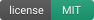
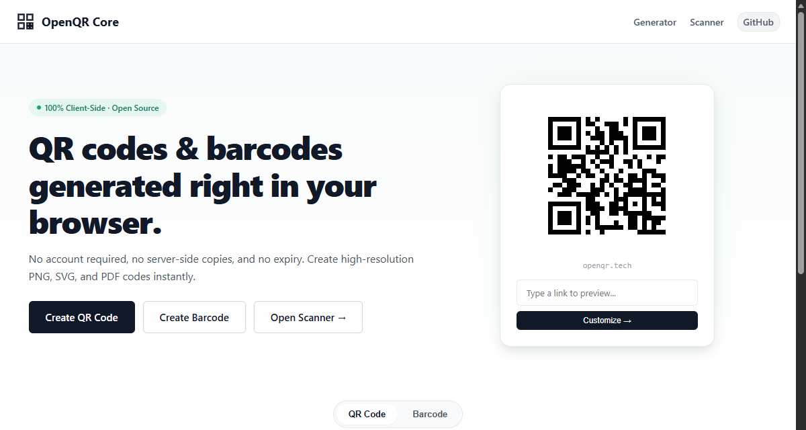
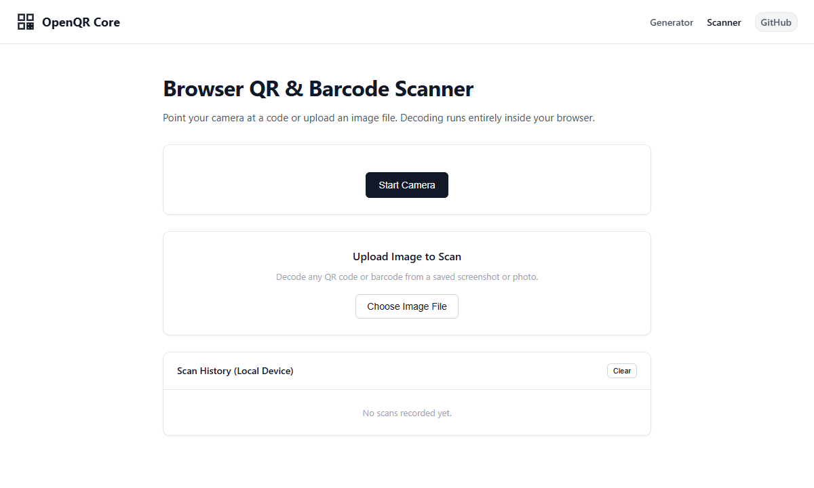

<p align="center">
  <picture>
    <source media="(prefers-color-scheme: dark)" srcset="assets/banner-dark.svg">
    <source media="(prefers-color-scheme: light)" srcset="assets/banner.svg">
    
  </picture>
</p>

<p align="center">
  <strong>Free, static, client-side QR code &amp; barcode generator and scanner.</strong><br>
  <em>Standalone snapshot of the core engine behind <a href="https://openqr.tech">openqr.tech</a> &middot; Snapshot: October 2026</em>
</p>

<p align="center">
  
  &nbsp;
  
  &nbsp;
  
</p>

<p align="center">
  <a href="#-what-it-can-do">What it can do</a> &bull;
  <a href="#-privacy--network-requests">Privacy &amp; Network</a> &bull;
  <a href="#-quick-start">Quick Start</a> &bull;
  <a href="#-differences-from-openqrtech">Differences from openqr.tech</a> &bull;
  <a href="#-license--trademark">License &amp; Trademark</a> &bull;
  <a href="#-third-party-software">Third-Party Notices</a>
</p>

---

## ✨ What it can do

OpenQR Core runs completely inside the user's browser. It has no backend, no database, no build toolchain, and does not require registration.

| Category | Capability | Details |
| :--- | :--- | :--- |
| **QR Code Types** | 8 Standard Static Formats | Website URL, Plain Text, Wi-Fi Network (`WPA/WEP/Open`), Contact Card (vCard 3.0), Email (`mailto:`), SMS (`smsto:`), Geo Location (`geo:`), Calendar Event (`BEGIN:VEVENT`). |
| **Styling & Defaults** | Free Baseline Defaults | Square module patterns, square corner eyes, custom hex foreground/background colors, transparent background option, and standard Error Correction Levels (`L`, `M`, `Q`, `H`). |
| **Sticker Frames** | 14 Canvas Sticker Borders | Pure client-side canvas composited frames (`bottom-pill`, `top-banner`, `phone-mockup`, `viewfinder`, `ticket-stub`, `minimal-card`, `chat-bubble`, `circle-badge`, `retro-polaroid`, `tag-hangtag`, `store-sign`, `laptop-screen`, `badge-ribbon`, `table-tent`, `neon-glow`) with custom text labels. |
| **Barcode Symbologies** | 4 Linear 1D Symbologies | Code 128, Code 39, UPC-A, and EAN-13 rendered via JsBarcode. |
| **Export Formats** | High-Resolution Outputs | Raster PNG (standard preview and high-res 2000px), clean vector SVG, and printable A4 PDF via jsPDF. |
| **Barcode & QR Scanner** | Live Camera & File Upload | In-browser camera scanning and image file drop decoding via html5-qrcode, with local device history saved in `localStorage`. |

---

## 📸 Preview

### Generator Interface
<p align="center">
  
</p>

### Scanner Interface
<p align="center">
  
</p>

---

## 🔒 Privacy & network requests

OpenQR Core is designed with a strict client-side model:

- **Browser-local processing**: Generation, vector rendering, canvas compositing, and barcode decoding execute on your computer inside your web browser. Content you type into the generator or scan with your camera is not sent to an OpenQR server.
- **CDN script loading**: The site loads open-source libraries (`html5-qrcode`, `JsBarcode`, `jsPDF`, `custom-qr-code`) from public CDNs (`cdnjs.cloudflare.com` and `esm.sh`) pinned with Subresource Integrity (SRI) hashes where supported.
- **Scanner product lookup**: When scanning a 6-to-14 digit retail barcode (such as UPC or EAN), the scanner makes a direct browser-to-API request to Open Food Facts (`world.openfoodfacts.org`) or Open Beauty Facts (`world.openbeautyfacts.org`) to display product metadata. Like any web request, this lookup reveals your IP address directly to those third-party services.
- **Local scan history**: Scanned items are stored strictly in your device's `localStorage` and can be cleared at any time.

---

## 🚀 Quick start

OpenQR Core requires no Node.js build step, runtime server, or external database.

### 1. Clone the repository
```bash
git clone https://github.com/NvxStrikes/OpenQR-Core.git
cd OpenQR-Core
```

### 2. Serve with any static web server
```bash
# Using Node.js npx serve
npx serve .

# Or using Python 3
python3 -m http.server 8080
```

### 3. Open in your browser
Navigate to `http://localhost:8080` (or `http://localhost:3000`).

---

## 🧩 Differences from openqr.tech

This repository contains a standalone, point-in-time snapshot of the free core static generator and scanner powering [openqr.tech](https://openqr.tech).

The hosted platform at openqr.tech includes additional hosted and commercial features not present in this static core:

- **Dynamic QR codes**: Cloud-backed editable destination URLs, campaign redirect management, and real-time scan analytics (country, city, device type).
- **Pro stylized patterns**: Dot shapes, rounded corners, classy markers, custom multi-color gradient fills, and Pro preview showcases.
- **Logo embedding**: Custom brand logo upload and automated error correction boosting.
- **User accounts**: Authentication via Google, GitHub, and email with cloud-synced generation history.
- **Canva integration**: Direct "Export to Canva" multi-page OAuth design builder.
- **Bulk generation**: Multi-row batch QR creation and ZIP archive packaging.

---

## 📜 License & trademark

- **Code License**: OpenQR Core source code is licensed under the [MIT License](LICENSE).
- **Trademark Notice**: The names **"OpenQR"**, **"OpenQR Core"**, the OpenQR logo, and openqr.tech branding are trademarks of NovaStrikes and are not covered by the MIT code license. You may not use NovaStrikes branding for commercial forks without permission.

---

## 🙏 Third-party software

This repository loads third-party open-source libraries from CDNs with pinned versions and Subresource Integrity (SRI) hashes where supported:

- **html5-qrcode** (Apache License 2.0) &copy; mebjas
- **JsBarcode** (MIT License) &copy; 2016 Johan Lindell
- **jsPDF** (MIT License) &copy; 2010-2025 James Hall, &copy; 2015-2025 yWorks GmbH
- **custom-qr-code** (MIT License) &copy; 2024 Andrej Nemec, &copy; 2019 Denys Kozak

Full upstream license texts and copyright notices are preserved in [THIRD_PARTY_NOTICES.md](THIRD_PARTY_NOTICES.md).
